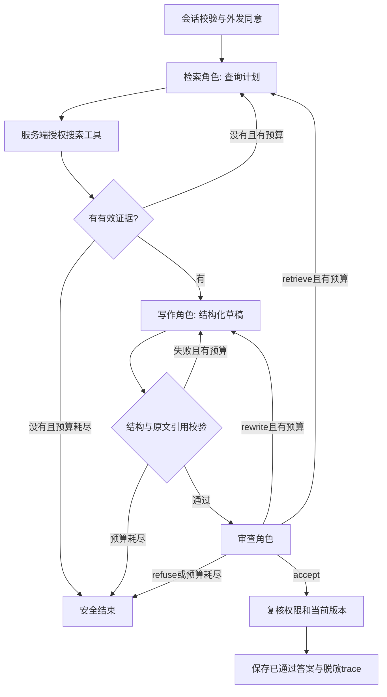

# 知序：LangGraph 多角色协作扩展与验收

日期：2026-11-06。用户明确要求为 Agent 实习投递扩展项目；代码、测试、文档由 AI 辅助完成，人工体验和真实问答质量仍待验证。

## 功能与边界

使用 LangGraph StateGraph 编排检索、写作、审查三个角色，复用现有 ChatClient、授权搜索和问答记录。检索角色输出查询计划，服务端调用固定授权工具；审查角色根据结构化结果决定通过、改写、重新检索或拒答。属于受控 Agent 工作流，不是通用自主规划平台。



- 默认最多两轮、六次角色聊天调用；两轮是处理预算，重写也消耗轮次。Embedding/Rerank 另计，不是所有外部请求最多六次。
- 默认120秒阶段预算；聊天请求使用剩余时间与45秒中的较小值。同步搜索/数据库调用不能被图预算强制中断，不声称硬实时截止。
- 图内状态包括轮次、反馈码和路由；证据和草稿是单请求闭包变量。未启用 checkpointer，不支持执行中的持久化断点续跑。
- 最终元数据复用 `QuestionRecord.details.agent_workflow`。不记录失败草稿、模型原始响应、检索查询和证据正文到 trace。
- `0010_agent_workflow` 只扩展问答终态检查约束，保留既有数据；有新终态记录时禁止直接降级，以免悄悄改写历史状态。
- 不是供应商原生 function calling：模型返回严格动作 JSON，后端白名单分发。模型不能指定项目或用户，也没有 SQL/shell 工具。
- 引用校验不是语义证明，审查模型也会误判。同一基座模型的角色分离不意味着错误独立。

## 关键代码

| 文件 | 职责 |
|---|---|
| `backend/app/agent_workflow.py` | 图、条件路由、预算、守卫、脱敏trace |
| `backend/app/generation.py` | 三种角色提示、Schema、模型HTTP适配、原文核验 |
| `backend/app/questions.py` | 模式入口、绑定身份/项目的搜索工具、阶段鉴权、最终落库 |
| `backend/migrations/versions/0010_agent_workflow.py` | 新终态约束 |
| `frontend/src/QuestionPanel.vue` | 模式切换、终态提示、完成后的角色记录 |
| `tests/test_agent_workflow.py` | 无数据库的图与适配器用例 |
| `tests/test_agent_questions.py` | 数据库/API/权限集成用例 |
| `scripts/demo_agent_workflow.py` | 不调用模型的八场景演示 |

## 启动和演示

在项目根目录执行，使用项目自身的 Python，不使用 PATH 中的 MSYS2 Python：

```powershell
uv sync --locked --dev
.\.venv\Scripts\python.exe -m alembic upgrade head
.\.venv\Scripts\python.exe -m scripts.demo_agent_workflow --output docs/evaluation/agent-workflow-offline.json
```

升级后重启后端，前端开发服务器会重新加载。完整本机启动沿用 `scripts/start-local.ps1`；不要同时启动第二套相同端口的服务。生产前端需在 frontend 下重新执行 `npm run build`。

在“知识问答”选择“检索、写作与独立审查”，使用自己授权且允许外发的测试资料，勾选外发同意。完成后展开“查看协作执行记录”。不勾选同意不会调用模型。基础引用问答仍可切换；API 缺省 `workflow_mode` 为 single，以保留旧调用方行为，页面默认选协作模式。

请求体示例（由正常登录客户端发送；不在文档硬编码令牌）：

```json
{
  "project_id": "替换为本人有权访问的项目UUID",
  "question": "项目成员如何访问资料？",
  "retrieval_mode": "hybrid",
  "workflow_mode": "multi_agent",
  "allow_external_processing": true
}
```

## 自动验证与演示口径

- 新增15项图/适配器用例、6项API集成用例，涵盖正常交接、改写、重新检索、无证据、坏引用、审查拒绝、模型失败、预算、超时、范围限制、撤权和资料撤下。
- 离线八场景：正常通过、改写后通过、重新检索后通过、拒绝、引用失败、无证据、上游不可用、调用预算停止；报告位于 `docs/evaluation/agent-workflow-offline.json`。
- 最终完整回归138项通过，Ruff F检查通过。首次完整回归发现新终态不满足旧数据库约束，补迁移后全量重跑通过；保留这个故障作为真实排查案例。
- 前端生产构建已验证；独立合成组件检查涵盖模式提交、trace展开、桌面与390px手机布局及JS错误检查，不连接真实模型或业务数据库。
- 本批未发起真实生成、Embedding或Rerank请求；八场景全部使用脚本替身。没有真实回答正确率、token成本或p95延迟结论。
- 尚未完成人工体验验收、30题真实质量评测、在线模型可用性复测、真实录屏。不得将合成组件截图当成真实问答效果截图。

## 面试准备与人工验收

1. 阅读图及角色Schema，亲自运行离线Demo并解释每一步。
2. 用同一资料和问题对比基础/协作两种模式，核对原文是否支持每条结论。
3. 亲自复现一个错误，保存实际改动和验证记录；AI辅助代码不等于本人已独立掌握。
4. 真实模型质量评测需固定资料版本、题目、标准证据与配置，并记录拒答、延迟、调用数及token。
5. 本地代码、依赖和数据库迁移与 GitHub 发布分别核对；本次不自动推送远程。
