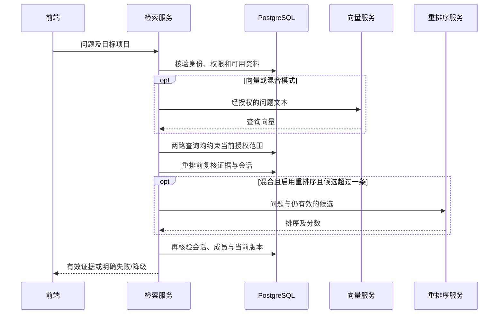

# 授权检索与重排序

日期：2026-11-02。状态：已实现并自动验证，待人工验收。复用0002_documents结构，本批无新迁移。

## 检索契约

`POST /api/search`，Bearer登录，JSON字段：

| 字段 | 规则 |
| --- | --- |
| project_id | 单个目标项目UUID，服务器检查当前成员关系 |
| query | 去除首尾空白后1—500字符 |
| mode | keyword、vector、hybrid；默认hybrid |
| top_k | 1—10，默认5 |
| candidate_limit | 5—50，默认20，且不小于top_k |
| use_rerank | 仅hybrid模式生效，默认true |
| allow_external_processing | 默认false；非keyword模式必须明确授权问题外发，以及启用重排时的候选片段外发 |

返回请求/实际模式、状态、警告、召回与融合计数、阶段耗时、追踪编号及证据。每条证据含片段/文档/版本ID、标题、正文、页码或段落行范围、召回通道和分数。E1等编号仅属于本次结果顺序，不是永久文档编号。

`POST /api/search/validate`接收project_id和最多10个chunk_ids，只返回当前有效ID，不返回正文、不调用模型。用于前端每5秒清理已失效结果；打开原文还会执行独立鉴权。

## 三种模式

- **关键词**：与入库一致的jieba分词，提取至多64个字母/数字/汉字等词元；参数绑定构造OR tsquery，simple配置查询TSVECTOR，按ts_rank_cd排序。仅本地执行，不使用重排序服务。
- **纯向量**：问题向量化后，在相同模型名称的当前版本片段中按余弦距离排序。显式引用public.vector和public向量运算符，隔离schema无需回退到public。不混入关键词或重排序，便于作基线。
- **混合**：两路分别召回，按chunk_id去重，RRF分数为各通道的`1 / (60 + 排名)`之和。截取candidate_limit个候选后，可交由重排序服务排序，再返回top_k条。

不同来源即使正文相同仍保留独立出处；不是把不同文档合并成一个证据。当前全文索引针对片段正文，未将文件名作为额外召回字段；只出现在文件名中的词可能不命中。中文检索暂不做语义改写、停用词优化或多阶段查询扩展。向量使用精确计算，当前没有HNSW索引，不声称已适用于大规模数据。

## 权限与时序

两路SQL都关联当前用户、有效项目成员关系、文档is_active、文档current_version_id与ready版本。纯向量额外检查embedding_model与当前配置一致；关键词查询不依赖向量模型。

模型请求前释放数据库事务，不持有锁等待外部服务。最终复核使用新SQL读取，不复用旧ORM对象作为权限依据。请求过程中成员被撤销、账号禁用、会话退出或过期时不返回证据；资料撤下或当前版本切换时移除旧片段并提示重新搜索。已经发出到服务的数据无法靠后续撤权撤回，重排前复核降低这一窗口，不能宣称实现跨网络原子授权。

## 降级与错误

| 情况 | 行为 |
| --- | --- |
| 当前项目无可用资料 | 空结果，不调用任何模型 |
| 纯向量服务失败 | HTTP503，不能偷偷切到关键词冒充向量基线 |
| 混合的向量服务失败 | 仅使用关键词，status=degraded且明确警告 |
| 重排序失败或格式非法 | 保留融合顺序，明确提示重排不可用 |
| 全部或部分向量模型名称不同 | 向量路跳过不兼容片段并提示；混合的关键词路仍可命中这些授权资料 |
| 重排期间证据失效 | 丢弃失效片段；剩余结果可能少于top_k，不自动重新调用模型补齐 |
| 项目不可访问或过程中会话失效 | 拒绝整个请求，不返回证据正文 |

模型名称检查不是完整模型指纹。相同名称但供应商、权重或参数发生变化时仍需主动重新入库；当前不能自动识别这些语义变化。客户端超时、HTTP错误及非法模型结果仅返回安全错误，不展示服务密钥或上游响应正文。

## 观测与边界

API响应提供embedding、keyword、vector、fusion、rerank、revalidate及total中实际执行的耗时。total是服务内检索耗时，含权限与数据库开销，不是浏览器端到端延迟；keyword计时包含分词，首次词典加载有冷启动成本。日志记录追踪编号、固定枚举、结果数及耗时，不记录问题和候选正文。

分数是排序依据，不是正确率或可回答性的保证。当前没有用未经标定的相似度阈值声称“答案可信”；真实质量与参数选择须通过后续人工标注评测。前端定时复核不能收回已下载或截图的内容，也不能替代服务端逐次鉴权。

参考：[PostgreSQL文本检索](https://www.postgresql.org/docs/18/textsearch-controls.html)、[pgvector Python集成](https://github.com/pgvector/pgvector-python)、[硅基流动重排序接口](https://docs.siliconflow.cn/docs/api/rerank-post)。
