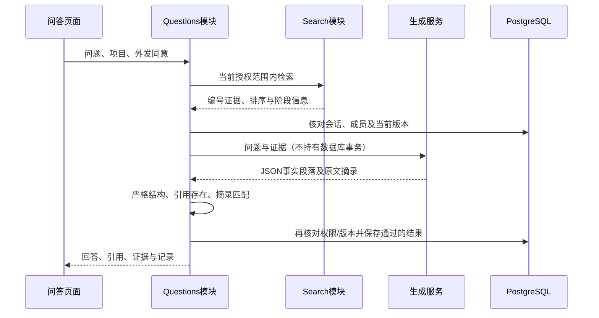

# 决策004：独立页面与引用问答

日期：2026-11-02。状态：已实现并自动验证，待人工验收。

## 页面边界

按用户反馈，将项目管理、资料与版本、证据检索、知识问答拆成四个独立页面。采用 Vue 条件挂载与 hash 地址，不新增路由依赖；路径为 `#/projects`、`#/documents`、`#/search`、`#/questions`，可携带 `?project=UUID`。支持前进、后退及刷新后登录恢复目标页面；会话凭据仅存内存，刷新仍需登录。

切页保留当前项目，功能页面可通过项目选择框切换范围。离开的页面销毁，未提交表单和检索结果不跨页保留，问答已保存记录可重新打开。导航只决定展示，后端继续独立核对权限。手机端提供同等四个入口。

## 生成流程和模块

`questions` 协调授权检索与生成，复用 `search.retrieve`，`generation.ChatClient` 隔离外部聊天协议。取最多5个有效片段赋予 E1 等编号，生成端仅接收问题、编号和正文，不接收账号、文件路径、令牌及旧回答。

每个事实段落必须附1—3条证据及至少8字符的连续摘录。服务端验证严格JSON结构、编号存在及归一化空白后的原文匹配，服务端拼接引用标记。模型不得自己插入标记；任何段落失败则丢弃整份草稿，不展示或保存失败草稿。

这只能验证引用来源和摘录存在，**不能验证语义蕴含、真实性或提示注入绝对安全**。页面明确提醒人工核对。系统提示将资料中的指令作为不可信数据处理，不提供任何工具调用能力。

## 状态与隐私

| 状态 | 行为 |
| --- | --- |
| answered | 展示校验后的段落和可点开的引用 |
| insufficient_evidence | 无片段或模型认为不足，展示固定提示 |
| generation_unavailable | 上游未配置/故障，展示提示和仍有效的检索证据 |
| invalid_citations | 截断、结构或引用校验失败，丢弃草稿，保留有效证据 |
| evidence_changed | 生成期间或历史读取时依据不再有效，隐藏整份回答及证据 |

生成前后复核真实会话、成员关系、有效文档与当前版本；撤权或退出时请求拒绝且不保存回答。没有片段不调用生成；关键词问答仍调用生成服务，因此也必须明确同意外发。混合检索的已有降级规则继续生效。

迁移 `0003_questions` 增加个人问答记录，保存已通过的答案、证据快照、模型/提示版本、检索信息及耗时。记录仅本人可读，即使同项目管理员也不能读取他人历史。项目权限撤销后不可读取自己的该项目历史；资料撤回或新版生效后，任一快照失效即隐藏整份旧回答，不把旧版本默认为当前依据。快照仍存本机数据库，隐藏不等于物理删除。

页面每7秒重新读取当前记录及历史，在权限/版本变化后更新显示；已经展示或下载的内容无法撤回。每次提问独立检索，不实现多轮记忆。无流式输出、语义蕴含模型、自动重试生成、共享历史或历史清理策略，后续根据实际需要扩展。

协议参考：[DeepSeek JSON模式](https://api-docs.deepseek.com/guides/json_mode/)、[聊天接口](https://api-docs.deepseek.com/api/create-chat-completion/)。DeepSeek域名使用关闭思考的参数；其他兼容服务不发送此供应商参数。
