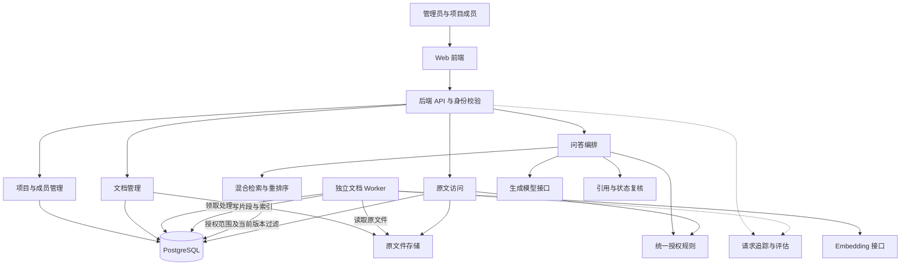

> 历史归档：2026-11-03 主资料统一前的版本，包含早期方案和阶段补充，不能作为当前功能、分工或验收依据。当前说明见 [系统介绍](../../系统介绍与整体开发流程.md) 与 [分工和汇报安排](../../小组成员分工.md)。

# 可信 RAG 知识服务系统介绍与整体开发流程

> 2026-11-02 更新：系统技术方案仍供开发评审，本文中的六人并行开发为历史组织方式。用户已决定负责全部开发，当前分工、状态与人工参与事项以 [开发协作与任务台账](../../开发协作与任务台账.md) 为准。

> 第四批实现更新：前端现为项目、资料、检索和问答四个独立页面，引用问答和个人历史已通过自动验证。历史保留证据快照，但读取时若依据不再是当前可用版本，就隐藏整份回答及证据；不将历史回答继续视为当前有效结论。引用仅检查编号与原文摘录匹配，语义支持关系和正式质量仍需人工评测。实际交付及限制见 [第四批验收](../../第四批验收.md)。

> 第六批更新：现已扩为七个独立板块，新增任务中心、检索评测和运行审计；默认100MiB流式上传及授权密码PDF解密已实现，校徽来自用户提供图片。此前固定20MB/不支持加密等约束为历史方案，当前实现、资源配置及限制以 [第六批验收](../../第六批验收.md) 和 [决策006](../../decisions/006-文件资源边界与七板块.md) 为准。正式30题人工质量评测尚未完成。

**课程：软件体系结构**  
**项目：面向高校科研团队的可信 RAG 知识服务系统架构设计与评估**  
**团队：6 人，全员参与设计、开发、联调、验收和个人板块汇报**  
**文档性质：开发方案；功能、实验和验收结果须以实际完成情况为准**  
**配套文档：[小组成员分工](./小组成员分工.md)**

## 1. 系统介绍

> 第八批实现更新：组织结构已扩为“团队—项目”两级。只有已确认教师能创建团队，学生通过编号申请入组；批准后仅获得公共库访问，内部项目另行授权。旧项目按单项目独立兼容团队迁移，原成员与资料保留，不推断教师身份。当前教师确认和权限规则见 [团队权限说明](../../团队权限与教师身份确认.md)。

### 1.1 我们要解决什么问题

实验室的论文、项目规范和课程资料往往分散存放。成员查找答案时，需要反复打开文档；资料更新后，还可能继续使用旧版内容；不同项目的内部资料也不能向所有人开放。

本系统集中管理这些资料，让用户通过自然语言提问，在有权访问的资料范围内获取带原文引用的回答。系统还需要处理资料更新、权限变化和模型接口异常。

例如，成员提问“项目要求使用哪些模型评测指标”，系统应检索其所属项目的资料，给出有依据的回答，并提供文档名称、版本和原文位置。若资料没有相关规定，应说明依据不足。

### 1.2 RAG 是什么

RAG 即检索增强生成。基本过程是：**先从知识库检索相关资料，再将证据交给大模型组织回答。** 上传文档通常是在建立检索索引，不是在重新训练生成模型。

本项目的“可信”落实到三个目标：

- **访问有边界：** 只检索和展示用户有权查看的资料。
- **回答有证据：** 答案关联可查看的原文片段，资料不足时说明限制。
- **知识有版本：** 当前问答使用有效版本，历史回答保留对应的证据版本信息。

这些机制降低错误和泄露风险，不意味着系统能够保证所有回答正确。引用是否存在和引用是否真正支持结论，需要分别检查。

### 1.3 用户与核心功能

| 用户 | 可以完成的操作 | 访问边界 |
| --- | --- | --- |
| 项目管理员 | 管理本项目成员，上传、更新和撤下资料，查看处理状态 | 仅管理获授权的项目 |
| 项目成员 | 选择可访问项目、提问、查看引用与原文 | 仅访问所属且有效的项目资料 |

原型可使用预置账号，项目成员关系由服务端保存和校验。项目初始化可通过脚本完成，无需第一阶段开发完整账号注册流程。

### 1.4 原型范围

| 必须完成 | 暂列扩展 |
| --- | --- |
| 文本型 PDF 与 Markdown 上传和解析 | 扫描件 OCR、复杂表格及图表理解 |
| 项目成员关系与服务端授权 | 校内统一身份认证、复杂组织权限 |
| 异步处理、片段及索引管理 | 大规模分布式任务调度 |
| 关键词与向量混合检索 | 知识图谱、多智能体检索 |
| 带引用问答、原文查看 | 复杂多轮会话记忆 |
| 版本切换、文档撤下、异常反馈 | 大规模缓存与自动扩缩容 |
| 请求追踪与离线评测 | 完整生产监控平台 |

第一阶段只回答当前问题，历史记录用于查看和追溯，不默认把旧回答作为新问题的证据。

## 2. 总体架构与技术基线

### 2.1 架构组织方式

采用**模块化后端、独立文档 Worker、离线建库与在线问答分离**的方式。逻辑模块通过明确接口协作，初期不拆成大量微服务。



未展示的其他受保护接口同样执行统一鉴权。图中的模块是职责边界，不代表都要独立部署；Embedding、重排序和生成接口可以封装在不同适配器中。

### 2.2 技术基线

| 部分 | 建议选择 | 开发约束 |
| --- | --- | --- |
| 前端 | Vue 3；团队更熟悉 React 时可整体替换 | 统一选择一种框架 |
| 后端 | Python FastAPI | 按项目、文档、检索、问答等模块组织 |
| 数据与索引 | PostgreSQL 与 pgvector | 业务、全文检索和向量检索集中管理 |
| 中文关键词处理 | 明确配置分词器 | 入库和查询使用相同处理规则 |
| 文档任务 | 数据库任务表与独立 Worker | 原子领取、租约、有限重试、幂等写入 |
| 原文件 | 本地受控目录 | 浏览器只通过后端鉴权接口读取 |
| 模型 | 封装 Embedding、重排序和生成适配接口 | 启动时固定实际模型、版本和配置 |
| 部署 | Docker Compose 或等效启动脚本 | 提供数据库初始化和完整启动说明 |

具体依赖版本、模型名称和调用方式在开发启动时核实并固定，记录到依赖文件与实验配置。不要把未经运行验证的接口样例当作已经兼容的实现。

### 2.3 六人模块对应

| 成员 | 主责模块 | 与其他模块的关系 |
| --- | --- | --- |
| 1 | 项目空间、基础 API 与架构 | 提供身份及成员关系数据，维护接口总表 |
| 2 | 文档入库与版本 | 为检索提供可用片段，为前端提供处理状态 |
| 3 | 混合检索与重排序 | 接收授权范围，向问答返回结构化证据 |
| 4 | 可信问答与统一授权 | 组织检索与生成，提供鉴权及引用校验 |
| 5 | 前端与原文溯源交互 | 对接项目、文档、问答和原文接口 |
| 6 | 可观测性与评测功能 | 提供追踪规范和评测工具，组织集成验证 |

六人都参与公共设计、接口评审、完整流程验收和 PPT 彩排。详细个人交付以配套分工文件为准。

## 3. 系统运行流程

### 3.1 资料上传与建库

```text
校验用户及项目管理权限
  → 校验文件类型和大小
  → 保存原文件
  → 创建文档版本及处理任务
  → Worker 领取任务
  → 解析正文和原文位置
  → 按章节分块
  → 生成向量及关键词索引
  → 检查片段和索引完整性
  → 标记版本可用并切换当前版本
```

数据库中的文档版本和任务创建采用事务提交。文件保存与数据库事务之间若发生异常，需要记录并清理无引用文件。失败任务按有限次数重试；超过次数标记失败并返回可读错误。

任务状态与版本状态分开：任务表示处理进展，版本表示资料是否可被使用。Worker 通过原子领取和租约控制并发，按版本与片段序号幂等写入，避免重试造成重复有效数据。

### 3.2 在线问答

```text
验证身份并计算可访问项目
  → 校验目标项目
  → 带授权与当前版本条件进行两路召回
  → 融合、去重、重排序
  → 复核证据权限和状态
  → 为证据分配引用编号
  → 组装上下文并调用生成模型
  → 检查引用编号及证据是否仍有效
  → 返回答案、状态和引用
```

项目编号来自请求，但是否可访问由服务端判断。授权过滤在关键词与向量两路查询中都要执行，不能先把无权限内容交给模型，再要求模型不要泄露。

原型先完成完整回答后再返回，避免流式输出已经发出内容后才发现权限变化。生成结束时证据若失效，丢弃该回答并提示重试。答案缓存暂不启用，减少权限和版本变化带来的失效问题。

### 3.3 原文查看与历史追溯

用户点击引用后，后端重新检查当前访问权限，再返回对应版本的原文。PDF 使用页码，Markdown 使用章节和段落位置。模型只输出引用编号，实际文档位置由后端映射。

历史问答保存所用版本和片段标识，但历史记录不是永久访问凭证。成员权限撤销或文档撤下后，相应历史答案、片段预览和原文访问同样受限。旧版本是否保留及保留多久，由小组明确记录；原型可保留用于授权追溯，但不参与新的默认检索。

### 3.4 异常处理

| 情况 | 预期行为 |
| --- | --- |
| 无项目权限 | 后端拒绝，不能返回受限正文或片段 |
| 文档解析失败 | 显示失败阶段，允许受控重试；旧版继续服务 |
| 检索不到有效证据 | 说明资料不足，不将回答标为有充分依据 |
| 模型超时或不可用 | 返回明确降级状态和授权资料片段 |
| 引用编号不存在 | 不作为有效来源展示，必要时降级为证据不足 |
| 生成期间权限或版本状态变化 | 丢弃失效回答，提示重新查询 |
| Worker 重复处理 | 幂等写入，不产生重复有效片段 |

## 4. 数据与接口先行约定

### 4.1 最小数据对象

| 对象 | 关键字段 |
| --- | --- |
| 用户与项目成员 | 用户 ID、项目 ID、角色、成员状态 |
| 文档 | 文档 ID、项目 ID、标题、当前版本 ID、可见状态 |
| 文档版本 | 版本 ID、文件摘要、存储位置、处理状态、创建时间 |
| 片段 | 片段 ID、版本 ID、章节、页码或段落位置、正文、向量 |
| 处理任务 | 任务 ID、版本 ID、状态、重试次数、租约截止时间、错误码 |
| 问答与证据 | 问题 ID、用户及项目、问题、答案、状态、所用证据与版本、模型配置、追踪 ID |
| 运行指标 | 追踪 ID、阶段、耗时、状态、错误、可获得的调用量 |

### 4.2 首批接口

| 接口 | 负责人 | 返回或行为 |
| --- | --- | --- |
| `GET /projects` | 1 | 当前身份可访问的项目 |
| `POST /documents` | 2 | 上传结果、文档 ID、版本 ID、任务 ID |
| `GET /tasks/{id}` | 2 | 授权任务的处理状态与失败原因 |
| `POST /documents/{id}/versions` | 2 | 创建新版本处理任务 |
| `POST /documents/{id}/withdraw` | 2，4提供授权 | 撤下文档，停止新检索及受限访问 |
| `POST /questions` | 4 | 答案、回答状态、引用、追踪 ID |
| `GET /documents/{id}/source` | 4，2提供存储 | 鉴权后返回对应版本原文 |
| 内部 `retrieve` | 3 | 按服务端授权范围返回结构化证据 |
| 评测命令行入口 | 6 | 批量执行并输出原始及汇总结果 |

每个接口先写请求、响应、错误和权限要求，再开始上下游开发。模拟响应与真实接口保持同一结构，联调时替换。

## 5. 系统整体开发流程

### 阶段一 明确需求与验收范围

**全员参加，成员 1 组织。**

1. 确认两类用户、两个示例项目及核心场景。
2. 确认必须实现和暂不实现的功能。
3. 将安全、性能、可用性、一致性和可维护性写成具体场景。
4. 确认六人主责、交叉复核关系、截止时间及 AI 记录方式。

**出口条件：** 每个需求都有负责人和验收行为，每个人知道自己的输入输出。产出需求清单、验收清单和初版架构。

### 阶段二 架构与接口评审

**每人提出本人模块方案，全员共同确认。**

1. 绘制上下文、模块、部署、入库及问答流程图。
2. 比较模块化单体与微服务、同步与异步处理、单路与混合检索等候选方案。
3. 确认共享数据、权限边界、版本语义和错误状态。
4. 固定 API 契约、证据对象及追踪字段。

**出口条件：** 所有上下游确认样例，关键选择有收益、代价和验证方法。产出架构决策记录及接口说明。

### 阶段三 环境与公共骨架

**成员 1、6 协调，全员在自己的环境运行。**

1. 建立代码目录、依赖版本、配置样例和数据库初始化脚本。
2. 配置模型接口，检查网络、凭据和模型可用性；凭据只放本地环境变量。
3. 初始化示例账号、项目与成员关系。
4. 建立日志规范、追踪 ID 和基本启动检查。
5. 使用公开样例资料验证一段文本的解析、向量化和生成调用。

**出口条件：** 六人都能按说明启动基础环境；实际模型及依赖配置有记录。产出运行说明和配置样例。

### 阶段四 完成最小端到端链路

先用一份文档跑通流程，再增加功能。

| 成员 | 第一轮必须提供 |
| --- | --- |
| 1 | 示例身份、项目及成员查询 |
| 2 | 文档上传、基础解析、片段与索引写入 |
| 3 | 基础向量检索，返回可用证据 |
| 4 | 鉴权、一次完整问答、引用映射 |
| 5 | 上传、提问和引用查看页面 |
| 6 | 请求追踪、冒烟验证及第一条评测用例 |

**出口条件：** 用户能上传一份文档，等待可用后提问并查看原文；基本授权从第一轮就生效，不推迟到最后补做。

### 阶段五 并行完善六个模块

1. 成员 1 完善项目及成员管理、公共响应与架构记录。
2. 成员 2 补齐异步任务、重试、幂等、版本更新和撤下。
3. 成员 3 补齐关键词召回、融合、重排序和模式切换。
4. 成员 4 补齐引用检查、证据不足、权限变化与模型故障处理。
5. 成员 5 补齐版本展示、异常反馈、原文定位和身份切换状态清理。
6. 成员 6 补齐指标采集、评测执行及结果汇总。

**出口条件：** 每人提交可运行模块、正常与异常样例、设计解释和 AI 使用记录，并完成一次交叉复核。

### 阶段六 全员联调与故障验证

按“基础链路 → 权限 → 版本 → 异常 → 观测”的顺序联调。每个问题记录复现步骤、预期、实际、负责人和复验结果。

至少验证以下场景：

- 正常上传、提问及引用查看。
- 项目 A 成员尝试读取项目 B 的资料。
- 新版本构建失败后旧版仍可查询，构建成功后检索切换。
- 文档撤下或成员权限撤销后，问答、历史记录及原文访问受到限制。
- Worker 重复执行、解析失败、模型超时和无证据问题。
- 追踪 ID 能关联一次请求的检索与生成耗时。

**出口条件：** 六人都独立完成一次完整验收，阻塞性问题关闭，未解决限制明确记录。

### 阶段七 对比评估

每人提供至少 5 道题，去重后保证不少于 30 道，覆盖精确术语、语义改写、跨文档、无答案、越权及版本变化。

采用相同授权资料比较基础向量检索与混合检索，固定生成模型与其他配置，记录：

| 指标 | 方法 |
| --- | --- |
| 检索 Recall@K | 每题命中的已标注相关证据数 ÷ 该题全部已标注相关证据数，再汇总；单一标注证据时另报告 Hit@K |
| 答案与引用质量 | 人工分别评估事实正确、证据支持和引用对应，交叉复核部分样本 |
| 无答案处理 | 同时观察无答案题正确提示和正常题误拒答 |
| 权限与版本 | 按预设场景检查是否出现越权、旧版混入或失效内容展示 |
| 延迟与调用量 | 报告样例数、重复次数、端到端及阶段耗时；小样本下谨慎解释 P95 |

**出口条件：** 结果可追溯到输入、证据、配置和原始记录；没有运行的实验标注为待验证。AI 可以辅助生成候选题，但标准答案与证据必须人工核对。

### 阶段八 汇报与交付

每人将本人设计、实现、验证及 AI 使用整理成对应 PPT，由本人讲解。统一图例、术语、数据和功能完成状态，准备稳定版本与备用录屏。

**出口条件：** 六人参与完整彩排，能解释本人代码和相邻模块接口；最终材料包含运行说明、评测证据及 AI 声明。

## 6. 两周建议里程碑

| 时间 | 阶段 | 必须看到的成果 |
| --- | --- | --- |
| D1—D2 | 需求与架构、接口确认 | 场景、分工、架构图、契约、AI 记录模板 |
| D3 | 环境与公共骨架 | 六人均可启动，身份和项目初始化可用 |
| D4—D5 | 最小链路 | 一份资料完成上传、问答与引用查看 |
| D6—D8 | 模块完善与交叉复核 | 混合检索、版本、异常处理、观测功能 |
| D9—D10 | 全员联调与评估 | 验收记录、原始结果、问题修复 |
| D11—D12 | 个人 PPT 与统一整合 | 各人负责板块、讲稿及真实 AI 声明 |
| D13—D14 | 彩排与冻结 | 稳定系统、最终材料、备用演示 |

D1 为实际启动日。时间不足时减少扩展和数据规模，保留核心权限、证据与版本语义，不以虚构实验补足材料。

## 7. 软件体系结构课程知识点

| 知识点 | 本项目体现 | 应留存的材料 |
| --- | --- | --- |
| 架构驱动因素 | 权限、可溯源、版本更新及故障约束 | 需求和质量场景 |
| 架构风格 | 分层、模块化单体、异步任务和处理流水线 | 模块与部署图 |
| 模块及接口 | 六个职责板块、证据对象、模型适配器 | 接口契约与依赖说明 |
| 运行时建模 | 问答调用、任务状态和版本切换 | 时序图及状态图 |
| 质量属性策略 | 鉴权、隔离、幂等、超时、降级、追踪 | 策略与验证对应表 |
| 决策及权衡 | 服务拆分成本、混合检索质量与延迟 | 架构决策记录 |
| 架构评估 | 场景验证、检索对比与故障注入 | 评测报告和风险清单 |
| 架构演化 | 模型替换、Worker 扩容、模块独立部署 | 后续演进及触发条件 |

汇报重点是“为什么这样组织系统、带来什么收益与代价、怎样验证”，而不仅是框架介绍和页面展示。

## 8. AI 参与与人工责任

**本文件以及此前的选题讨论、初步架构和分工文档，已由本聊天 AI 助手辅助起草或修改。** 本文件是待小组评审的开发方案，不代表系统已实现、实验已完成或内容已全部人工核验。

各成员在需求、设计、编码、测试和 PPT 阶段持续记录 AI 使用，至少包含日期、使用人、工具及模型、用途、涉及成果、采纳与人工修改、核验结果、记录位置。具体模型无法确认时写“未确认”。

人工责任包括：核实参考资料、解释并验证代码、确认评测证据、如实报告结果、审查最终 PPT。AI 参与不能替代个人系统贡献和本人答辩。

声明位置与配套分工文件一致：代码及模块说明、个人记录、PPT 开头、各人板块、结尾或附录。

> 声明模板：本项目使用［实际工具及模型］辅助［具体任务］，对应成果见［文件或模块］。负责人进行了［人工修改与核验］，尚未验证的部分为［内容］。使用记录见［位置］，最终决策、验收及实验报告由小组负责。

## 9. 最终交付检查

- [ ] 系统介绍、架构图和实际行为一致。
- [ ] 六人均有系统实现、交叉复核和完整验收记录。
- [ ] 核心链路、权限、引用、版本及异常行为已验证。
- [ ] 代码、依赖、配置样例、初始化与启动说明齐全。
- [ ] 评测问题、人工标注、配置和原始结果可追溯。
- [ ] 每人亲自讲解对应 PPT，并能解释本人实现。
- [ ] AI 使用记录及全组、个人声明与真实情况一致。
- [ ] 模拟、未实现和未验证内容均明确标注。
