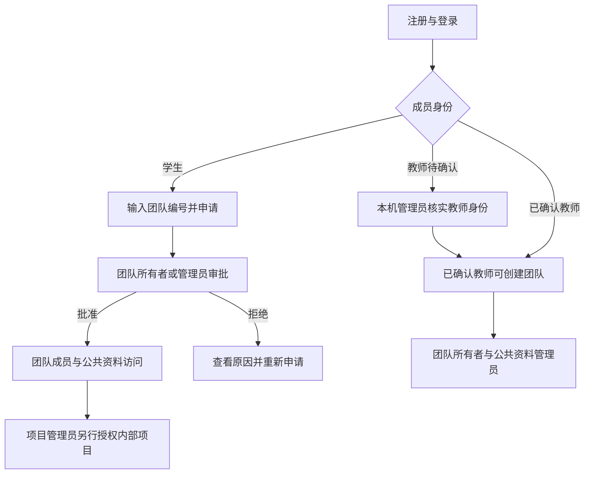

# 团队权限与教师身份确认

日期：2026-11-03。当前规则按用户最新要求实现：只有已确认教师可创建团队，学生不可创建。本文由AI辅助编写，实际身份核实由本机管理员负责。

## 用户从哪里开始

注册时选择学生或教师。注册只建立账号，没有团队资格，不会获得既有项目或公共资料访问权。教师选项是身份申请，不是权限授予。



教师也可申请加入其他团队。教师身份不授予跨团队或全部内部项目访问权。一个账号可以加入多个团队；教师/学生身份与团队角色、项目角色分开存储和判断。

## 教师身份由谁确认

当前本机原型没有学校统一身份认证或平台管理员网页。只有持有本机项目运行环境及数据库凭据的可信管理员，可以在核实真实身份后通过本地管理工具确认。普通网页用户不能调用确认接口，也不能在注册或个人资料请求中提交 `teacher_verified` 获权。

在仓库根目录执行，用户名使用精确中文或英文用户名：

```powershell
# 查看注册时申请教师、尚未确认的用户名；不输出邮箱或密码
./.venv/Scripts/python.exe -m backend.teacher_accounts pending

# 先人工核实真实身份，再确认（将示例替换为实际用户名）
./.venv/Scripts/python.exe -m backend.teacher_accounts approve "教师用户名"

# 如需撤回创建新团队的资格
./.venv/Scripts/python.exe -m backend.teacher_accounts revoke "教师用户名"
```

确认后需要重新登录，页面才会读取新的身份状态。已有旧账号也可由管理员核实后直接确认；不能根据姓名、演示账号名或项目管理员角色推断其是教师。

旧账号可以在“个人资料”自行补充学生身份或申请教师身份；选择教师仍是待确认状态，不会取得创建权限。已确认教师不能从网页自行改为学生，身份变更由本机管理员处理。

`revoke` 只撤回“已确认教师”标记，从而禁止创建新团队；不自动清除既有团队/项目角色。若需要停止访问，应另外移除团队成员或停用账号。此工具是本机管理入口，尚无学校身份系统对接或独立教师认证审计平台。

## 三种不同的角色

| 维度 | 值 | 含义 |
| --- | --- | --- |
| 学术身份 | 学生、教师待确认、教师已确认、旧账号身份待补充 | 组织展示；只有已确认教师能创建团队 |
| 团队角色 | 所有者、管理员、普通成员 | 所有者可转交所有权/委派管理员；管理员可审批入组、维护团队公共资料和移除普通成员 |
| 项目角色 | 项目管理员、项目成员 | 只作用于具体项目，沿用原来的版本/资料/问答权限 |

所有者可把学生委派为团队管理员，帮助处理日常事务；该学生仍不能创建新团队。所有权只能转交给另一位已加入团队的已确认教师。

已入组的普通成员可以在所属团队内创建项目并担任该项目管理员；这不是创建团队。团队管理员也不能越过内部项目成员关系读取其未参与项目的资料。

## 公共资料和内部项目

每个团队有唯一的“团队公共资料”库，底层复用独立项目及现有入库、检索、问答、评测链路。审批通过时，仅自动增加团队成员资格与公共库只读资格，不自动加入内部项目。

- 公共库所有者/管理员与团队管理角色同步，普通团队成员只读。
- 内部项目的参与者必须先是该团队已批准成员，再由项目管理员授予项目权限。
- 不允许通过普通项目成员接口修改公共库成员或名称；公共库跟随团队角色和成员变动管理。
- 原文、分块、检索、问答、历史、任务、评测和审计都校验团队资格；检索SQL也加入团队成员条件，不能仅依赖前端隐藏。
- 未加入团队的人只能凭编号提交申请、查看自己的申请结果，不能查看团队成员、资料或他人申请。申请者的联系信息仅对审批管理员开放。

## 退出、移除与重新加入

成功退出或被移除后，同事务删除团队资格及该团队所有公共/内部项目成员关系；已有登录会话后续访问也被拒绝，模型调用前后继续复核。重新申请并获批准后只恢复公共库资格，内部项目需重新授权。

团队所有者必须先转交所有权才能退出。若成员仍是某内部项目最后一位管理员，退出/移除会返回冲突，需要先由项目管理员转交管理权，避免遗留无人维护的项目；系统不会暗中把私有资料交给团队所有者。

已经下载或展示过的资料无法撤回。当前页面刷新、重新访问以及检索/问答周期校验会更新状态，不声称能清除对方已保存的数据。

## 既有数据如何兼容

迁移0007为每个既有项目分别创建一个兼容团队，不合并不同项目成员。保留原项目ID、项目角色、资料、版本和问答等记录，新增空公共库；现有项目成员被承接为团队成员，不伪造入组申请。

在原项目管理员中按稳定顺序选择一位兼容团队所有者，其余管理员承接为团队管理员。**这不认定他们为教师，也不授予创建新团队的资格**；旧账号学术身份保持“待补充”。历史上学生创建过项目时，也只承接其既有管理关系，不将其伪称为教师。用户后续可以核实身份、转交所有权或调整成员。

本次真实迁移逐项验证原8个项目、12条项目授权、7个账号、13份资料、17个版本、60个片段保留。验证发生于本轮浏览器新建合成账号之前；后续测试数据不属于这份迁移基线。报告在 `.local/team-migration-check.json`。

## 当前实现范围

新增 `teams`、`team_memberships`、`team_applications` 三表，共16张应用表及迁移管理表；项目新增团队ID和公共库标记，用户新增学术身份与教师确认标记。

编号只用于定位申请目标，不是免审批邀请码。相同用户/团队保留一条当前申请；拒绝或撤回后可再次提交，审批状态变化记录在公共库审计中。本人申请列表最多100条，管理员审批列表首版展示最近100条；未提供全校团队搜索、通知邮件、团队删除、项目跨团队迁移或学校SSO接入。
