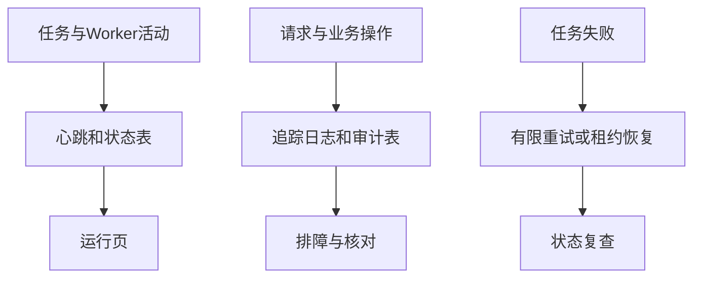

# 万顺焱的板块实现与PPT准备说明

负责板块为**运行审计与质量评估**。系统为“知序——高校科研团队知识管理与协作平台”。

更新日期为2026-11-06，依据功能提交172743a及当前代码整理。建议负责3页、讲解约3分钟，最终时长按课程要求调整。

## 板块定位

负责解释系统运行时怎样发现故障、恢复任务、保留操作依据，以及测试结论的适用范围。评测中心已移出工作区导航，内部评测表、接口和脚本仍用于实验准备。

## 先读这些代码

| 文件与入口 | 阅读重点 |
| --- | --- |
| [backend/app/runtime.py](../../backend/app/runtime.py) 中的 `ingestion_status、project_tasks、audit_events` | 心跳、任务计数、日期范围及授权审计查询。 |
| [backend/worker.py](../../backend/worker.py) 中的 `heartbeat、claim、renew、run_loop` | 活动上报、租约领取、续租和数据库故障退避。 |
| [backend/app/audit.py](../../backend/app/audit.py) 中的 `record_event` | 操作成功时在业务事务中写入审计事件。 |
| [frontend/src/TaskCenter.vue](../../frontend/src/TaskCenter.vue) 中的 `load、filter、retry` | 状态、创建日期、分页与重试确认。 |
| [frontend/src/RuntimeCenter.vue](../../frontend/src/RuntimeCenter.vue) 中的 `load` | 任务计数、日志追踪信息与审计。 |
| [backend/app/evaluation.py](../../backend/app/evaluation.py) 中的 `内部评测接口` | 草稿样例、单题多配置检索对比和本人实验记录。 |

推荐先读前端入口了解用户操作，再读业务入口及数据模型，最后读对应测试。无需逐行朗读代码，应能解释输入、状态变化、输出和失败处理。

## 实现流程

1. Worker运行时上报心跳，运行页依据90秒窗口判断最近是否有活动。心跳只能反映近期活动，模型和任务状态需另查。
2. 领取任务使用数据库行锁和SKIP LOCKED，任务有300秒租约和随机令牌。最多领取3次，长任务各阶段续租。
3. Worker故障后任务可在租约过期后被重新领取。可重试异常设置等待，数据库连接异常由主循环按退避重连。
4. 请求带trace_id，入库日志记录阶段耗时和安全原因码，审计记录操作者、对象、操作、时间及必要元数据。
5. 任务中心支持状态与创建日期范围。日期按浏览器时区转换，结束日期转换成下一天零点并采用小于条件，覆盖整天。
6. 运行页显示成功和失败任务。当前按用户明确描述，两个卡片都跳到失败筛选。可以说明此交互约定而不把它解释成成功任务查询。
7. 评测工具已有单题三配置对比，正式30题标注、批量汇总和语义质量结论待完成。

## 对应的软件体系结构知识

| 知识点 | 本板块中的体现与取舍 |
| --- | --- |
| 可靠性与故障恢复 | 有限重试、租约、令牌验证和事务发布共同处理进程故障与重复执行。 |
| 可观测性 | 日志、任务状态、心跳和审计各有职责。凭trace_id将一次请求的结果与排障信息关联。 |
| 体系结构评估 | 以质量场景说明刺激、环境、响应与指标，再给出测试方法和真实结果。自动回归与人工语义评测分别陈述。 |

## 可直接制作的三页PPT

### 第1页　运行观测

**页面要点**　心跳、成功/失败任务、任务日期过滤与trace_id。

**建议配图或演示**　截图运行页和失败任务筛选。

**口头讲解参考**　“运行状态需要多种信息一起判断，心跳帮助定位Worker近期活动。”

### 第2页　恢复和审计

**页面要点**　租约300秒、最多3次领取、失败退避、事务发布和成功操作审计。

**建议配图或演示**　画Worker中断到租约恢复的流程，配一条脱敏审计。

**口头讲解参考**　“系统为恢复保留状态，也用令牌防止旧Worker发布。”

### 第3页　测试证据与评估计划

**页面要点**　112项既有回归、5项新增回归分别通过，正式人工质量评测待完成。

**建议配图或演示**　表格列权限、版本、恢复和UI测试，再列待完成的人工标注。

**口头讲解参考**　“我们已经验证若干结构与故障边界，答案质量仍需用人工证据标注和真实实验评估。”

标题与要点可直接改写进幻灯片。截图由本人在当前版本实际操作后制作，图表中需要区分教学示例与真实实验结果。

## 本人演示和检查

进入运行页查看当前项目计数，再点击卡片进入失败任务筛选并设置创建日期。使用专门合成的失败资料演示重试。读取一条成功审计记录，解释操作者、对象、操作与trace_id。故障注入只在隔离测试环境执行。

演示前阅读[本地启动说明](../本地开发启动.md)，确认前端、API、数据库与Worker就绪。首次使用公共或获授权的演示资料，模型服务可用性以当次检查为准。

## 答辩准备

**测试数字代表准确率吗？**

112和5是自动回归用例数量，分别运行通过。正式答案质量需要标注语料与真实对比结果，当前尚未完成。

**Recall、倒数排名和MRR怎么讲？**

Recall@5是前5结果覆盖人工标准片段的比例。单题倒数排名为首个相关结果排名的倒数，MRR需要对数据集各题结果求均值。无正例的不可回答题不能把空集合召回率写成100%。

**删除是否清理了磁盘？**

当前资料和团队删除采用保留后台文件与审计的逻辑策略。资料列表删除没有用户恢复入口，磁盘空间回收需要后续单独设计。

## 与其他成员衔接

前一位讲解结束时说明本板块的输入来自哪里，下一位接过输出继续讲。与其他成员共享同一个项目和文件例子，避免把同一套总体架构重复讲六次。

## AI参与与个人贡献记录

本说明由AI辅助依据代码编写。项目的主要设计、实现和自动验证使用AI辅助，用户是唯一已确认的人工开发负责人。本人承担该板块学习、核查和讲解，实际完成的评审、验收、标注或代码修改按证据填写。

建议在本部分页脚注明“实现说明与讲稿由AI辅助，本人完成内容核查与讲解”，核查完成后再使用这句话。尚未核查时记录为待核查。

| 日期 | 本人实际完成的事项 | 产物或证据 | AI辅助范围 |
| --- | --- | --- | --- |
| 待填写 | 待实际完成后填写 | 阅读笔记、截图、测试记录或提交 | 按实际填写 |

返回[成员说明目录](README.md)或查看[系统主介绍](../系统介绍与整体开发流程.md)。
