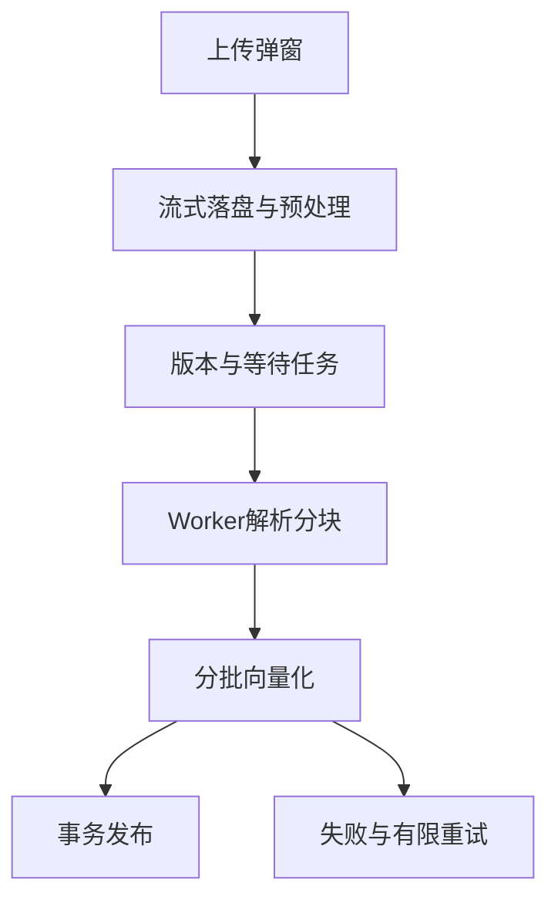

# 周炎青的板块实现与PPT准备说明

负责板块为**文件版本与异步入库**。系统为“知序——高校科研团队知识管理与协作平台”。

更新日期为2026-11-06，依据功能提交172743a及当前代码整理。建议负责3页、讲解约3分钟，最终时长按课程要求调整。

## 板块定位

负责解释文件怎样从上传变成可检索的片段。一次上传可以选择多份文件，每份独立提交和生成版本与任务。成功文件继续处理，失败文件保留在弹窗中供重试。资料撤下、恢复、删除的行为需要讲清楚。

## 先读这些代码

| 文件与入口 | 阅读重点 |
| --- | --- |
| [frontend/src/DocumentLibrary.vue](../../frontend/src/DocumentLibrary.vue) 中的 `upload、load、confirm` | 多文件弹窗、单文件密码、版本列表、撤下恢复删除与失败反馈。 |
| [backend/app/documents.py](../../backend/app/documents.py) 中的 `save_version、restore、delete_document` | 流式落盘、版本和任务创建、访问生命周期。 |
| [backend/app/file_processing.py](../../backend/app/file_processing.py) 中的 `isolated、_child` | 子进程内解析和PDF解密，IPC传递密码。 |
| [backend/app/ingestion.py](../../backend/app/ingestion.py) 中的 `parse_and_chunk` | 文本抽取、定位、分块与资源限制。 |
| [backend/app/office.py](../../backend/app/office.py) 中的 `office_sections` | 解析DOCX正文、XLSX工作表和PPTX幻灯片文字。 |
| [backend/worker.py](../../backend/worker.py) 中的 `claim、process、fail` | 领取任务、生成向量、发布与重试。 |

推荐先读前端入口了解用户操作，再读业务入口及数据模型，最后读对应测试。无需逐行朗读代码，应能解释输入、状态变化、输出和失败处理。

## 实现流程

1. 管理员打开上传弹窗，一次最多选择20份文件，勾选文本外发许可。多个PDF可分别填写密码。
2. 后端每次处理一个文件，按1MiB块写入磁盘，检查大小、文件名和类型。批量部分成功时不会要求重传成功文件。
3. 加密PDF在子进程解密，密码通过管道传递。成功保存解密副本，密码不持久化。Office采用ZIP/XML文字提取。
4. 写盘和预处理完成后重新检查权限，创建 document_versions 和 ingestion_tasks，返回202。
5. Worker通过带跳过锁机制的查询领取任务，设置租约和令牌。解析、分块后按批生成1024维向量。
6. 全部完成后在一个数据库事务中发布片段、版本状态与当前版本指针。失败时旧的可用版本继续使用。
7. 撤下会关闭访问并取消未完成任务。恢复开放已有版本，并让被中断的最新版本重新排队。删除仅针对撤下资料，列表隐藏且访问拒绝，文件和审计仍保留。

## 对应的软件体系结构知识

| 知识点 | 本板块中的体现与取舍 |
| --- | --- |
| 异步架构与状态机 | API返回已接受，Worker负责耗时任务。任务状态包含queued、processing、succeeded、failed、cancelled，版本成功状态为ready。 |
| 事务与一致性 | 新版本原子发布，查询只用当前ready版本，避免半份索引和新旧混用。 |
| 可靠性与资源隔离 | 子进程超时终止、文件/文字/片段上限、租约和有限重试共同约束资源。队列使用数据库，便于本机运行。 |

## 可直接制作的三页PPT

### 第1页　从文件到任务

**页面要点**　批量入口、流式写盘、PDF密码处理，202表示接受请求。

**建议配图或演示**　画上传到任务表的流程，截图批量上传弹窗。

**口头讲解参考**　“上传成功和索引就绪是两个状态，用户可以先看到后台任务。”

### 第2页　异步入库与版本发布

**页面要点**　Worker领取、解析、向量化、事务发布，以及旧版继续服务。

**建议配图或演示**　画queued到终态的状态图，标出ready版本指针。

**口头讲解参考**　“只有所有片段和向量准备完成后，我们才切换当前版本。”

### 第3页　恢复与文件类型

**页面要点**　撤下、恢复、删除，Office文字提取和原文件下载。

**建议配图或演示**　用表格比较三种操作对访问、任务和列表的影响。

**口头讲解参考**　“恢复是重新开放已有资料，删除则结束这份资料在产品中的可见性。”

标题与要点可直接改写进幻灯片。截图由本人在当前版本实际操作后制作，图表中需要区分教学示例与真实实验结果。

## 本人演示和检查

使用两份公开或获授权的演示文件，观察任务从等待到就绪。更新其中一份文件并证明旧版在处理中仍可查。再演示撤下、恢复和删除，删除只用专门准备的合成资料。

演示前阅读[本地启动说明](../本地开发启动.md)，确认前端、API、数据库与Worker就绪。首次使用公共或获授权的演示资料，模型服务可用性以当次检查为准。

## 答辩准备

**支持哪些Office文件？**

现代格式DOCX、XLSX和PPTX。提取文字用于检索，原始排版通过下载查看，旧版DOC/XLS/PPT和OCR未实现。

**文件限制是多少？**

默认100MiB，PDF500页，文字50万字符，1500片段，隔离解析60秒，处理预算240秒。Office解包另有64MiB总量和单XML8MiB限制。参数与预算不等于所有外部等待的绝对总耗时。

**Worker重复执行会重复发布吗？**

领取和续租使用租约令牌，发布检查当前令牌。发布时删除该版本旧片段并在同一事务写入，片段ID由版本与序号确定。

## 与其他成员衔接

前一位讲解结束时说明本板块的输入来自哪里，下一位接过输出继续讲。与其他成员共享同一个项目和文件例子，避免把同一套总体架构重复讲六次。

## AI参与与个人贡献记录

本说明由AI辅助依据代码编写。项目的主要设计、实现和自动验证使用AI辅助，用户是唯一已确认的人工开发负责人。本人承担该板块学习、核查和讲解，实际完成的评审、验收、标注或代码修改按证据填写。

建议在本部分页脚注明“实现说明与讲稿由AI辅助，本人完成内容核查与讲解”，核查完成后再使用这句话。尚未核查时记录为待核查。

| 日期 | 本人实际完成的事项 | 产物或证据 | AI辅助范围 |
| --- | --- | --- | --- |
| 待填写 | 待实际完成后填写 | 阅读笔记、截图、测试记录或提交 | 按实际填写 |

返回[成员说明目录](README.md)或查看[系统主介绍](../系统介绍与整体开发流程.md)。
