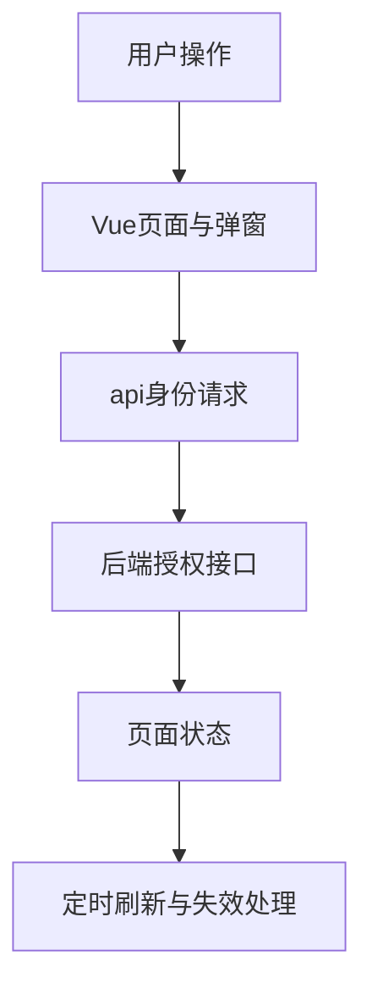

# 杨柳铭的板块实现与PPT准备说明

负责板块为**前端与端到端体验**。系统为“知序——高校科研团队知识管理与协作平台”。

更新日期为2026-11-06，依据功能提交172743a及当前代码整理。建议负责3页、讲解约3分钟，最终时长按课程要求调整。

## 板块定位

负责说明用户怎样完成从入组到使用知识的完整路径。系统当前有六个工作区页面，前端采用Vue 3和Vite，用hash记录页面与当前项目。重点展示页面职责、交互反馈和与后端接口的协作。

## 先读这些代码

| 文件与入口 | 阅读重点 |
| --- | --- |
| [frontend/src/Workspace.vue](../../frontend/src/Workspace.vue) 中的 `pages、readRoute、syncRoute、api、saveDialog` | 登录状态、六页面导航、项目上下文和全局编辑入口。 |
| [frontend/src/TeamWorkspace.vue](../../frontend/src/TeamWorkspace.vue) 中的 `findTeams、startApplication、confirmAction` | 团队搜索、审批、组织操作及确认弹窗。 |
| [frontend/src/FormDialog.vue](../../frontend/src/FormDialog.vue) 中的 `原生dialog封装` | 模态显示、Esc、遮罩、关闭按钮、焦点和滚动处理。 |
| [frontend/src/DocumentLibrary.vue](../../frontend/src/DocumentLibrary.vue) 中的 `upload、confirm、preview` | 批量上传、部分失败、版本和资料操作。 |
| [frontend/src/files.js](../../frontend/src/files.js) 中的 `openSource、downloadFile` | 带身份请求原文，在新标签页安全渲染内容并下载。 |

推荐先读前端入口了解用户操作，再读业务入口及数据模型，最后读对应测试。无需逐行朗读代码，应能解释输入、状态变化、输出和失败处理。

## 实现流程

1. 登录后令牌和用户状态保存在内存，由api封装给请求附上Bearer身份。旧身份请求返回时进行令牌比较，避免旧响应覆盖新账号页面。
2. 六个页面分别承担团队与项目、资料与版本、证据检索、知识问答、处理任务、运行审计。hash包含当前页面与项目ID，支持前进后退。
3. 项目切换后按项目ID重新创建业务组件。组件加载时请求服务端授权数据，卸载时停止定时器并屏蔽迟到响应。
4. 创建、编辑与高影响操作通过FormDialog呈现。原生dialog.showModal提供焦点范围，关闭恢复焦点，保存过程中禁用关闭和重复提交。
5. 批量上传逐文件提交，单个失败不丢失整批的成功结果。密码在提交后清空，失败原因显示在弹窗内，剩余失败文件可重试。
6. 原文打开先同步创建新标签页，再进行授权请求，避免异步后打开被拦截。通过textContent写入文字，PDF使用blob预览，Office展示提取文字和下载入口。
7. 桌面使用侧栏，手机显示顶部身份与导航。任务状态轮询与界面反馈帮助用户理解等待和失败。

## 对应的软件体系结构知识

| 知识点 | 本板块中的体现与取舍 |
| --- | --- |
| 表现层与业务层分离 | 前端组织体验，后端确认角色和访问范围。可见按钮由角色引导，接口持续检查权限。 |
| 状态与生命周期 | 项目切换、卸载、并发请求和迟到响应会影响界面一致性，需要对应的清理与请求序号。 |
| 可用性与可修改性 | 复用弹窗统一错误和操作反馈，按业务拆分页面，响应式布局适配手机。 |

## 可直接制作的三页PPT

### 第1页　六页面与用户旅程

**页面要点**　展示页面地图，串起加入团队、公共资料、内部项目、问答。

**建议配图或演示**　准备桌面全景与手机页面截图。

**口头讲解参考**　“我们按用户任务拆页面，用当前项目作为各板块共享上下文。”

### 第2页　弹窗与批量操作

**页面要点**　个人资料、项目编辑、上传、确认四类交互，展示部分失败后的重试。

**建议配图或演示**　截图一个表单弹窗和一个确认弹窗。

**口头讲解参考**　“表单在弹窗内预填和反馈，用户能保留输入并继续处理错误。”

### 第3页　端到端与边界处理

**页面要点**　权限变化、请求失败、处理中提示、新标签原文、移动端。

**建议配图或演示**　制作操作到接口的时序图，演示一次原文新页。

**口头讲解参考**　“前端体验需要同时处理成功路径、等待路径和失效路径。”

标题与要点可直接改写进幻灯片。截图由本人在当前版本实际操作后制作，图表中需要区分教学示例与真实实验结果。

## 本人演示和检查

用合成账号打开个人资料、取消修改，再编辑自己的合成项目。进入公共库批量选择演示文件，搜索文件名，查看版本并新开原文页。在手机宽度检查弹窗、表格横向滚动和顶部导航。

演示前阅读[本地启动说明](../本地开发启动.md)，确认前端、API、数据库与Worker就绪。首次使用公共或获授权的演示资料，模型服务可用性以当次检查为准。

## 答辩准备

**为什么要用弹窗？**

创建和编辑需要明确的输入、提交、取消边界，模态弹窗还能避免插入表单打乱当前页面布局。

**刷新浏览器后为什么需要登录？**

令牌保存在内存，页面刷新会清空该状态。当前实现按这一方案处理会话。

**Office是否还原了原始排版？**

当前预览提取的文字并提供原文件下载，原文渲染方式在新页说明中写明。

## 与其他成员衔接

前一位讲解结束时说明本板块的输入来自哪里，下一位接过输出继续讲。与其他成员共享同一个项目和文件例子，避免把同一套总体架构重复讲六次。

## AI参与与个人贡献记录

本说明由AI辅助依据代码编写。项目的主要设计、实现和自动验证使用AI辅助，用户是唯一已确认的人工开发负责人。本人承担该板块学习、核查和讲解，实际完成的评审、验收、标注或代码修改按证据填写。

建议在本部分页脚注明“实现说明与讲稿由AI辅助，本人完成内容核查与讲解”，核查完成后再使用这句话。尚未核查时记录为待核查。

| 日期 | 本人实际完成的事项 | 产物或证据 | AI辅助范围 |
| --- | --- | --- | --- |
| 待填写 | 待实际完成后填写 | 阅读笔记、截图、测试记录或提交 | 按实际填写 |

返回[成员说明目录](README.md)或查看[系统主介绍](../系统介绍与整体开发流程.md)。
