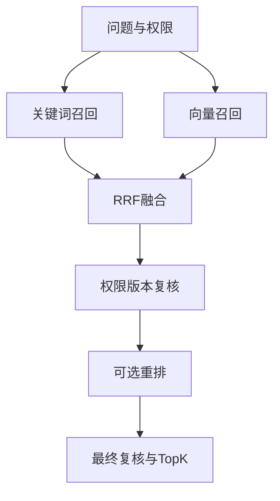

# 毕云飞的板块实现与PPT准备说明

负责板块为**检索与重排序**。系统为“知序——高校科研团队知识管理与协作平台”。

更新日期为2026-11-06，依据功能提交172743a及当前代码整理。建议负责3页、讲解约3分钟，最终时长按课程要求调整。

## 板块定位

负责把“用户的一句话”转成相关且有权访问的证据。检索页展示片段和原文，问答模块再基于这些片段组织回答。讲解时重点比较关键词、向量和混合检索如何互补。

## 先读这些代码

| 文件与入口 | 阅读重点 |
| --- | --- |
| [backend/app/search.py](../../backend/app/search.py) 中的 `authorized_scope、keyword_candidates、vector_candidates、fuse、retrieve` | 权限过滤、双路召回、RRF融合、重排及复核。 |
| [backend/app/model_client.py](../../backend/app/model_client.py) 中的 `EmbeddingClient、RerankClient` | 三方接口适配和向量维度、排序格式检查。 |
| [frontend/src/SearchPanel.vue](../../frontend/src/SearchPanel.vue) 中的 `search、validate、loadHistory` | 模式选择、结果、下载与私人检索历史。 |
| [backend/app/models.py](../../backend/app/models.py) 中的 `Chunk、SearchHistory` | 片段、关键词索引、向量及检索问题记录。 |

推荐先读前端入口了解用户操作，再读业务入口及数据模型，最后读对应测试。无需逐行朗读代码，应能解释输入、状态变化、输出和失败处理。

## 实现流程

1. 接收问题、project_id、检索模式和TopK，检查会话及当前项目资格。只有获得许可才向外部向量/重排服务发送所需内容。
2. authorized_scope把有效团队、团队成员、项目成员、有效资料、当前ready版本限制放进查询范围。
3. 关键词路用jieba分词，借助PostgreSQL全文索引匹配。向量路把问题变成1024维向量，在兼容模型建库的片段上进行精确距离检索。
4. 混合模式默认候选上限20，融合按RRF计分。一个结果在多个召回列表出现时，累加1/(60+排名)，无需把关键词分数与向量分数直接相加。
5. 融合后复查当前权限和版本，候选多于1条且启用重排时，发送问题和候选正文给重排服务。
6. 返回前再复核，排除调用期间失效的片段，默认返回5条，附文件、版本、位置、来源及排序信息。
7. 检索问题保存到当前用户和项目的私人历史，界面显示最近20条。下载通过带身份验证的原文件接口重新检查访问权。

## 对应的软件体系结构知识

| 知识点 | 本板块中的体现与取舍 |
| --- | --- |
| 管道与过滤器 | 召回、融合、重排、复核形成可替换的处理阶段。 |
| 适配器与可修改性 | Embedding和Rerank客户端隔离服务协议，但换向量模型仍需考虑原索引模型和维度。 |
| 性能与可用性取舍 | 本机使用精确向量扫描，实现直接，数据量增大后需评估近似索引。混合模式向量失败可回退关键词，重排失败保留融合排序并显示降级。 |

## 可直接制作的三页PPT

### 第1页　两条召回路径

**页面要点**　关键词适合精确术语，向量适合语义表达，默认候选20、返回5。

**建议配图或演示**　用同一个合成问题画双路召回图。

**口头讲解参考**　“两条路各自覆盖不同表达，再合并候选。”

### 第2页　RRF与重排序

**页面要点**　展示RRF公式，解释候选排序后再由重排模型判断相关性。

**建议配图或演示**　用假设排名演示一条证据在两路中累加分数，标注教学示例。

**口头讲解参考**　“RRF融合排名，重排再精读问题与候选内容。”

### 第3页　安全与实际验证

**页面要点**　展示授权过滤、两次复核、降级警告、下载与历史。

**建议配图或演示**　截图检索结果及过程详情，实验结果仅使用真实记录。

**口头讲解参考**　“模型调用期间权限会变化，所以过滤需要贯穿整个流程。”

标题与要点可直接改写进幻灯片。截图由本人在当前版本实际操作后制作，图表中需要区分教学示例与真实实验结果。

## 本人演示和检查

先用同一问题比较关键词和混合检索，记录命中片段、相关性和耗时，允许不同模式结果不同。点击原文与下载，并重进页面查看个人历史。只用获授权语料，正式质量图应待人工标注和实验完成后制作。

演示前阅读[本地启动说明](../本地开发启动.md)，确认前端、API、数据库与Worker就绪。首次使用公共或获授权的演示资料，模型服务可用性以当次检查为准。

## 答辩准备

**RRF公式代表什么？**

对候选在各召回列表中的排名r，累加1/(60+r)。它融合排名，最终数值用于排序，不代表答案正确概率。

**为什么没有HNSW？**

当前是本机课程规模，现有实现使用精确扫描。未来可基于数据量和召回/延时实验评估近似索引。

**重排失败会怎样？**

混合召回已得到的融合顺序继续返回，并带RERANK_UNAVAILABLE警告。纯向量模式遇到向量故障会明确失败。

## 与其他成员衔接

前一位讲解结束时说明本板块的输入来自哪里，下一位接过输出继续讲。与其他成员共享同一个项目和文件例子，避免把同一套总体架构重复讲六次。

## AI参与与个人贡献记录

本说明由AI辅助依据代码编写。项目的主要设计、实现和自动验证使用AI辅助，用户是唯一已确认的人工开发负责人。本人承担该板块学习、核查和讲解，实际完成的评审、验收、标注或代码修改按证据填写。

建议在本部分页脚注明“实现说明与讲稿由AI辅助，本人完成内容核查与讲解”，核查完成后再使用这句话。尚未核查时记录为待核查。

| 日期 | 本人实际完成的事项 | 产物或证据 | AI辅助范围 |
| --- | --- | --- | --- |
| 待填写 | 待实际完成后填写 | 阅读笔记、截图、测试记录或提交 | 按实际填写 |

返回[成员说明目录](README.md)或查看[系统主介绍](../系统介绍与整体开发流程.md)。
