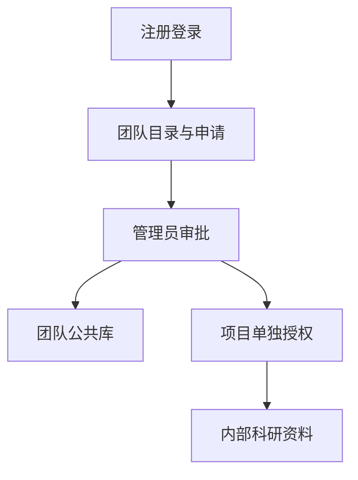

# 肖淦的板块实现与PPT准备说明

负责板块为**总体架构与组织权限**。系统为“知序——高校科研团队知识管理与协作平台”。

更新日期为2026-11-06，依据功能提交172743a及当前代码整理。建议负责3页、讲解约3分钟，最终时长按课程要求调整。

## 板块定位

把系统讲成一个面向高校科研团队的知识平台。教师建立团队，学生申请加入，批准后进入团队公共库，内部科研项目还需管理员单独授权。RAG是平台中的知识服务能力。选题背景可以用“实验室规范、研究资料散落在文件夹，版本更新后仍引用旧文件，成员不同却需要不同访问范围”展开。

## 先读这些代码

| 文件与入口 | 阅读重点 |
| --- | --- |
| [backend/app/dependencies.py](../../backend/app/dependencies.py) 中的 `current_user、require_team、require_membership` | 从会话识别账号，统一检查团队有效性、团队资格和项目成员关系。 |
| [backend/app/teams.py](../../backend/app/teams.py) 中的 `directory、apply、review、transfer、delete_team` | 组织团队目录、申请审批、管理交接及逻辑删除。 |
| [backend/app/routes.py](../../backend/app/routes.py) 中的 `create_project、update_project、put_member` | 项目创建、编辑与项目内授权。 |
| [backend/app/models.py](../../backend/app/models.py) 中的 `User、Team、TeamMembership、TeamApplication、Project、Membership` | 将学术身份、团队角色和项目角色分别建模。 |

推荐先读前端入口了解用户操作，再读业务入口及数据模型，最后读对应测试。无需逐行朗读代码，应能解释输入、状态变化、输出和失败处理。

## 实现流程

1. 注册或登录后，后端从 Bearer 会话摘要查出有效账号，不能用请求中的用户ID冒充其他人。
2. 已确认教师可以创建团队。选择“教师”只表示申请身份，本机可信管理员通过教师确认工具核实资格。
3. 申请人用团队名称或简介模糊搜索目录，看到人数与简介并提交申请。目录查询排除已加入及待审批团队。
4. 团队管理员批准后建立团队成员关系，并授予公共库资格。团队公共库实际是带 is_team_library 标记的项目。
5. 内部项目使用单独 memberships 授权。团队管理员进入私人项目时同样需要项目成员关系。
6. 退出或移除成员会撤销下属项目授权。所有者退出前须交接给另一位已确认教师。删除团队通过名称确认后关闭整个团队。

## 对应的软件体系结构知识

| 知识点 | 本板块中的体现与取舍 |
| --- | --- |
| 分层与模块化 | Vue负责交互，FastAPI负责业务与授权，PostgreSQL负责持久化，Worker处理入库。模块职责清晰，同时避免课程原型维护多个网络服务。 |
| 安全与最小权限 | 三种角色维度独立，身份确认不等同于授予项目权限。审批与撤权是服务端规则。 |
| 架构权衡 | 模块化后端便于本机部署，但共享数据库带来耦合。按组织层级加锁维持一致性，会增加并发写入等待。 |

## 可直接制作的三页PPT

### 第1页　背景与使用场景

**页面要点**　资料分散、旧版引用、团队与项目授权三个痛点。用学生入组后查实验规范作为贯穿案例。

**建议配图或演示**　画“教师—团队—公共库/内部项目”关系图。

**口头讲解参考**　“我们先明确谁能够访问哪些知识，再提供检索和问答服务。”

### 第2页　整体架构与职责

**页面要点**　展示前端、模块化API、独立Worker、PostgreSQL与文件存储、三类模型适配器。

**建议配图或演示**　从系统主介绍复制总体架构图，突出在线问答和异步入库两条线。

**口头讲解参考**　“文件处理耗时，因此用独立Worker；在线查询通过同一个业务后端组织。”

### 第3页　权限与架构取舍

**页面要点**　解释学术身份、团队角色、项目角色，批准入组只开放公共库。

**建议配图或演示**　制作三行角色表，演示学生无法创建团队、无法越权访问内部项目。

**口头讲解参考**　“权限判断落在后端入口，页面按钮只负责引导操作。”

标题与要点可直接改写进幻灯片。截图由本人在当前版本实际操作后制作，图表中需要区分教学示例与真实实验结果。

## 本人演示和检查

用合成教师和学生账号演示创建、申请、审批。先让学生进入公共库，再证明未授权内部项目不可见，最后授权并重新查看。截图应标注演示账号和当前页面，避免把测试账号当作真实教师认证。

演示前阅读[本地启动说明](../本地开发启动.md)，确认前端、API、数据库与Worker就绪。首次使用公共或获授权的演示资料，模型服务可用性以当次检查为准。

## 答辩准备

**为什么教师也不能查看所有项目？**

学术身份解决创建资格，项目成员关系解决资料访问范围。分开后能表达不同科研项目之间的保密边界。

**为什么不拆成微服务？**

当前目标是稳定本机展示。模块化后端加独立Worker已隔离主要耗时任务，服务拆分需要额外处理网络故障、部署和分布式一致性。

**数据库有多少表？**

当前17张应用表，另有Alembic迁移管理表。成员可引用主介绍中的完整表职责，讲解时重点选六张组织和授权相关表。

## 与其他成员衔接

前一位讲解结束时说明本板块的输入来自哪里，下一位接过输出继续讲。与其他成员共享同一个项目和文件例子，避免把同一套总体架构重复讲六次。

## AI参与与个人贡献记录

本说明由AI辅助依据代码编写。项目的主要设计、实现和自动验证使用AI辅助，用户是唯一已确认的人工开发负责人。本人承担该板块学习、核查和讲解，实际完成的评审、验收、标注或代码修改按证据填写。

建议在本部分页脚注明“实现说明与讲稿由AI辅助，本人完成内容核查与讲解”，核查完成后再使用这句话。尚未核查时记录为待核查。

| 日期 | 本人实际完成的事项 | 产物或证据 | AI辅助范围 |
| --- | --- | --- | --- |
| 待填写 | 待实际完成后填写 | 阅读笔记、截图、测试记录或提交 | 按实际填写 |

返回[成员说明目录](README.md)或查看[系统主介绍](../系统介绍与整体开发流程.md)。
