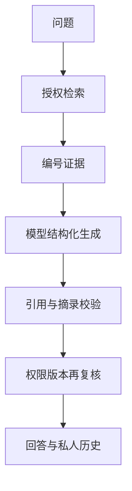

# 陈凤的板块实现与PPT准备说明

负责板块为**引用问答与权限复核**。系统为“知序——高校科研团队知识管理与协作平台”。

更新日期为2026-11-06，依据功能提交172743a及当前代码整理。建议负责3页、讲解约3分钟，最终时长按课程要求调整。

## 板块定位

负责解释模型怎样基于知识库证据给出有出处的回答。一次问答独立检索，成功后展示逐项结论和引用。证据不足、服务异常或引用失败时有对应状态。

## 先读这些代码

| 文件与入口 | 阅读重点 |
| --- | --- |
| [backend/app/questions.py](../../backend/app/questions.py) 中的 `ask、valid_evidence、output_record` | 问答编排、调用前后复核、保存和读取个人历史。 |
| [backend/app/generation.py](../../backend/app/generation.py) 中的 `ChatClient.generate、AnswerDraft、source_quote、validate_claims` | 结构化生成、提示词及引用摘录检查。 |
| [frontend/src/QuestionPanel.vue](../../frontend/src/QuestionPanel.vue) 中的 `ask、openCitation、openRecord` | 逐项回答、证据、新标签页原文和私人历史。 |
| [tests/test_questions.py](../../tests/test_questions.py) 中的 `问答与引用回归` | 失败草稿不保存、PDF空白匹配、撤权和版本变化。 |

推荐先读前端入口了解用户操作，再读业务入口及数据模型，最后读对应测试。无需逐行朗读代码，应能解释输入、状态变化、输出和失败处理。

## 实现流程

1. 用户明确选择公共库或内部项目并提交问题，勾选外发许可。系统调用检索管道获取当前授权证据。
2. 证据带有E1、E2等编号。生成服务收到问题和编号正文，系统提示限制只使用这些证据中的事实，忽略资料中试图改变规则的指令。
3. 模型返回严格JSON，包括answerable和claims。每条claim含text及1—3条supports，每条support包括evidence_id和原文quote，最多8条结论。
4. 后端检查JSON结构、可回答标志与结论一致、引用编号存在、摘录至少8个非空白字符。忽略PDF排版空白后核对连续文字，标点和文字必须匹配。
5. 匹配成功时还原原文中的真实摘录，服务端为结论添加引用。任一段校验失败则隐藏整份草稿，保留安全的原因分类和已授权证据。
6. 生成后复核权限、版本和正文。通过后保存本人问答记录。后续读取历史时再次复核，依据变化会隐藏整份旧回答和证据。

## 对应的软件体系结构知识

| 知识点 | 本板块中的体现与取舍 |
| --- | --- |
| 编排与契约 | 检索与生成分离，Pydantic模型定义模型输出契约。服务返回成功还需要业务结构检查。 |
| 安全与一致性 | 外部调用前后复核，避免长调用期间撤权或换版导致旧证据继续展示。 |
| 可信边界 | 来源核验能检查摘录来自何处，结论是否由该摘录支持仍需语义评审。严格拒绝草稿减少无据内容，也可能让用户重试。 |

## 可直接制作的三页PPT

### 第1页　RAG回答闭环

**页面要点**　画出检索、模型生成、核验、引用与原文流程。

**建议配图或演示**　展示一条实际成功回答及引用按钮。

**口头讲解参考**　“模型负责组织结论，系统负责提供证据并约束输出。”

### 第2页　引用契约与PDF问题

**页面要点**　列出text、evidence_id、quote，解释空白兼容修复。

**建议配图或演示**　用自行编写的中文断行例子对照，避免公开手册正文。

**口头讲解参考**　“原文中的换行属于排版差异，忽略空白后仍必须逐字匹配。”

### 第3页　失败与可信边界

**页面要点**　依据不足、服务不可用、引用错误、证据变化四类反馈。

**建议配图或演示**　表格列状态及界面行为，说明人工语义核验任务。

**口头讲解参考**　“可核对的来源是质量保障的一环，还需要人判断证据是否支持结论。”

标题与要点可直接改写进幻灯片。截图由本人在当前版本实际操作后制作，图表中需要区分教学示例与真实实验结果。

## 本人演示和检查

演示一个资料能够直接回答的问题，再问一个语料中没有答案的问题。成功案例打开引用原文并人工核查。历史失效验证使用合成资料，撤下或更新后重开历史。旧的失败草稿未保存，需重新提问。

演示前阅读[本地启动说明](../本地开发启动.md)，确认前端、API、数据库与Worker就绪。首次使用公共或获授权的演示资料，模型服务可用性以当次检查为准。

## 答辩准备

**是不是只返回检索文件？**

成功时大模型会生成结论，文件和引用是证据入口。失败状态下只保留可核对证据，截图中的PDF空白误拒绝已经修复。

**引用通过就代表答案正确吗？**

仍需检查逻辑和语义。摘录可能真实存在，却不能支持模型写出的结论，正式评测需人工核对。

**有多轮对话吗？**

当前每次问题独立检索。历史用于回看，不把旧回答直接当作下一题的证据。

## 与其他成员衔接

前一位讲解结束时说明本板块的输入来自哪里，下一位接过输出继续讲。与其他成员共享同一个项目和文件例子，避免把同一套总体架构重复讲六次。

## AI参与与个人贡献记录

本说明由AI辅助依据代码编写。项目的主要设计、实现和自动验证使用AI辅助，用户是唯一已确认的人工开发负责人。本人承担该板块学习、核查和讲解，实际完成的评审、验收、标注或代码修改按证据填写。

建议在本部分页脚注明“实现说明与讲稿由AI辅助，本人完成内容核查与讲解”，核查完成后再使用这句话。尚未核查时记录为待核查。

| 日期 | 本人实际完成的事项 | 产物或证据 | AI辅助范围 |
| --- | --- | --- | --- |
| 待填写 | 待实际完成后填写 | 阅读笔记、截图、测试记录或提交 | 按实际填写 |

返回[成员说明目录](README.md)或查看[系统主介绍](../系统介绍与整体开发流程.md)。
