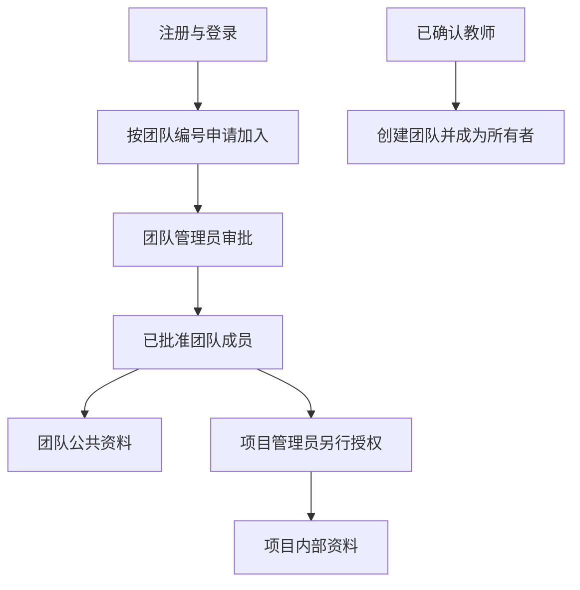
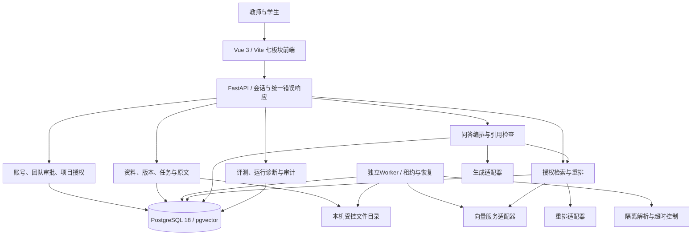
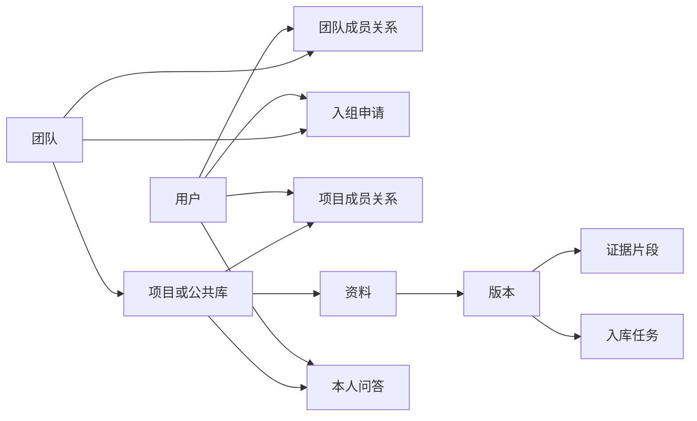

# 知序——高校科研团队知识管理与协作平台

更新日期：2026-11-03。本文依据当前代码与第九批自动验证结果重写，作为当前系统介绍和开发流程主文档。旧版混合方案已保留在 [历史目录](history/2026-11-03-before-system-refresh/系统介绍与整体开发流程.md)。

课程：重庆邮电大学软件工程硕士《软件体系结构》。课程汇报题目：**面向高校科研团队的知识管理与协作平台：软件体系结构设计与评估**。品牌简称“知序”，仓库标识保留 `trusted-rag-lab`。

用户是唯一已确认的人工开发负责人，AI辅助主要设计、编码、排障、自动验证和文档。六人汇报板块不代表六人均已编码，实际贡献及人工验收见 [开发台账](开发协作与任务台账.md)。

## 1. 背景、对象与价值

高校实验室与科研项目组会积累论文、技术规范和实验资料。文件分散导致查找费时，更新后旧版本可能继续使用，不同项目内部资料也需要区分访问范围。通用聊天模型未必掌握团队自己的规定，其回答还需要可核对的出处。

知序以团队组织师生，以项目划分知识边界，在获授权资料上提供检索和引用问答。当前“协作”具体指入组审批、角色权限、通讯录及资料共享，尚无共同编辑、即时聊天、经费管理或完整项目进度管理。

| 对象 | 主要需求 | 当前作用 |
| --- | --- | --- |
| 教师 | 建立团队、审批成员、维护公共资料 | 身份确认后创建团队，管理入组和公共库 |
| 学生 | 加入实验室、查找规定、联系成员 | 申请加入，查看获授权资料和师生通讯录 |
| 项目管理员 | 管理参与范围与资料 | 编辑项目、授权成员、更新版本 |
| 课程评审者 | 核查架构与质量结论 | 查看模块、状态机、权限、故障与实验记录 |

例如，学生获批入组后可以阅读公共实验规范；加入项目A后才可检索项目A内部文件。询问“项目要求使用哪些评测指标”时，系统先检索证据，再组织附引用的回答。依据不足或模型异常时应明确说明。

## 2. 业务结构与角色

注册支持中文用户名、QQ邮箱及学生/教师身份申请。**只有本机可信管理员核实并确认的教师可创建团队；学生和待确认教师不可创建。** 旧账号可在个人资料补充身份，但自行选择教师不授予确认资格。当前未接学校SSO，操作见 [教师身份确认](团队权限与教师身份确认.md)。

| 维度 | 角色 | 边界 |
| --- | --- | --- |
| 学术身份 | 学生、教师待确认、教师已确认、旧账号待补充 | 已确认教师可创建团队，不自动获得所有项目权限 |
| 团队角色 | 所有者、管理员、普通成员 | 管理入组、公共库与组织；所有者可委派管理员、交接或删除团队 |
| 项目角色 | 项目管理员、项目成员 | 管理或读取具体内部项目；团队管理员不能越过项目成员关系 |

已入组成员可在所属团队创建项目并成为该项目管理员，这与创建团队不同。QQ邮箱对同团队成员和相关审批管理员开放，全局精确用户名搜索不返回邮箱。邮箱未验证归属，mailto只打开用户本机邮件应用，不自动发信。

退出/移除会撤销团队及下属项目授权，重新入组只恢复公共库资格。所有者须先交接给另一位已确认教师才能退出；最后一位项目管理员也需交接。团队删除仅所有者可执行，需预览范围并输入完整名称，属于逻辑删除：关闭访问、申请和未完成任务，保留底层数据与审计，目前无恢复入口。

## 3. 七个业务板块与实际范围

| 板块 | 已实现能力 | 限制 |
| --- | --- | --- |
| 团队与项目 | 注册、个人资料、创建/申请/审批、师生通讯录、项目编辑与授权、退出/交接/逻辑删除 | 教师由本机管理员确认；无全校团队搜索或跨团队迁移 |
| 资料与版本 | PDF/Markdown、密码PDF解密、版本与原文、资料撤下 | 无OCR；资源有上限；重写PDF不保证签名保真 |
| 证据检索 | 中文关键词、纯向量、混合召回、RRF与重排、原文定位 | 精确向量扫描，未部署HNSW或搜索集群 |
| 知识问答 | 授权证据、结构化生成、引用/摘录检查、本人历史与失效隐藏 | 无复杂多轮记忆和语义真实性自动判定 |
| 处理任务中心 | 状态筛选、分页、重试时间与租约 | 依赖独立Worker；等待不等于处理成功 |
| 评测中心 | 人工草稿/样例、单题三配置对比、本人历史及JSON导出 | 30题批量汇总和正式人工语义评审未完成 |
| 运行与审计 | 心跳、队列、资源上限、追踪和成功操作审计 | 心跳不是整体健康证明；无防数据库管理员篡改审计 |

## 4. 总体架构与技术基线

采用模块化FastAPI后端、独立文档Worker，在线检索/问答与异步入库分开运行。图中的模块是职责边界，不是已经拆分部署的微服务。

| 部分 | 当前实现 | 依据 |
| --- | --- | --- |
| 前端 | Vue 3 + Vite，hash导航，凭据仅在内存 | frontend/src |
| 后端 | Python 3.13、FastAPI、SQLAlchemy | backend/app |
| 数据库 | 原生PostgreSQL 18、pgvector 0.8.7、迁移0008 | backend/migrations |
| 检索 | jieba、全文索引、1024维精确向量召回、RRF k=60 | backend/app/search.py |
| 模型 | 可配置聊天、向量与重排适配器；曾使用deepseek-flash及两种Qwen服务 | 配置示例与适配器，密钥仅本机保存 |
| 文件处理 | multipart暂存后分块写盘；IPC传密码给本机子进程 | documents.py、file_processing.py |
| 后台任务 | 数据库任务表、SKIP LOCKED、租约、有限重试、原子发布 | backend/worker.py |
| 运行 | 本机前端5173、API8000、原生数据库与Worker | start-local.ps1、stop-local.ps1 |

依赖固定在 `uv.lock` 和 `frontend/package-lock.json`。React替换、Docker Compose、消息中间件和学校SSO不属于已部署能力。

## 5. 核心处理流程

### 上传、解密与版本发布

1. 获授权管理员上传资料并同意向量服务处理提取文字，可提供有权使用的PDF密码。
2. 请求体受大小限制，应用按块写盘；预处理不长期持有项目锁。
3. 密码PDF在隔离子进程中解密。密码不写数据库、日志、命令行或密码文件，保存的是授权成员可读的解密副本。
4. 文件准备后重新检查团队/项目资格，再建立版本与queued任务。
5. Worker校验、解析分块并分批向量化，检查租约与超时。
6. 全部成功后单事务发布片段、版本和任务；失败保留旧有效版本，不发布半份索引。

默认上限为100MiB文件、500页PDF、50万字符、1500片段、单次隔离解析60秒和入库处理预算240秒，可通过本机配置调整。这不是浏览器断点续传，预算也不是所有网络/数据库等待的绝对总墙钟保证。

### 检索、生成与历史

每次明确选择一个团队公共库或内部项目，不默认跨库混合回答。检索SQL限制有效团队成员、项目成员、有效资料及当前ready版本。混合检索融合关键词/向量候选并可重排；故障按模式降级、保留已有证据或明确失败。

生成端只接收问题和编号证据。严格检查JSON结构、引用存在及原文摘录匹配，由服务端拼接引用。失败草稿丢弃；依据不足或服务不可用时给出提示。**引用匹配不证明语义蕴含或事实正确**，仍需人工检查结论。

调用前后复核权限和版本，读取历史时也复核；失效依据使旧回答隐藏。本人问答和实验历史不向其他成员或项目管理员开放。

### 恢复与删除

任务租约300秒，最多3次领取；向量暂时故障可等待重试，数据库故障由Worker退避重连。记录追踪/任务ID与耗时，不记录密钥、正文或异常SQL参数。

团队删除按团队、项目、资料、任务的统一顺序加锁，关闭访问并取消任务/申请、撤销授权、保留数据。已发给模型的输入和已下载文件无法撤回。

## 6. 数据设计

当前16张应用表，另有 `alembic_version`。原文件在本机磁盘，数据库保存位置、校验及结构化数据；引用/证据快照使用JSONB，没有单独的引用表。

| 表 | 职责 |
| --- | --- |
| app_users | 账号、密码哈希、QQ邮箱、学术身份与教师确认 |
| app_sessions | 会话摘要和到期时间 |
| teams | 团队信息、编号与逻辑删除标记 |
| team_memberships | 团队成员及所有者/管理员/成员角色 |
| team_applications | 当前申请和审批状态 |
| projects | 所属团队、项目说明与公共库标记 |
| memberships | 项目管理员/成员关系 |
| documents | 资料主体、撤下状态和当前版本指针 |
| document_versions | 文件哈希、版本状态、片段数及向量模型 |
| ingestion_tasks | 处理阶段、尝试次数、租约、等待及错误 |
| chunks | 正文、页码/行号、关键词索引与向量 |
| question_records | 本人问答、引用、快照、模型/提示版本及耗时 |
| evaluation_cases | 人工草稿/样例与标准片段 |
| evaluation_runs | 本人实验配置、指标和结果快照 |
| worker_heartbeats | Worker近期活动 |
| audit_events | 成功操作元数据，不存原始请求体 |

`/api/auth/*` 管理账号，`/api/teams*` 和 `/api/team-applications*` 管理组织审批，`/api/projects*` 管理项目权限，`/api/documents*` 与 `/api/tasks*` 管理资料/任务，`/api/search` 和 `/api/questions` 提供知识服务。评测和运行接口也受团队/项目资格约束。教师确认没有网页自授权接口。

## 7. 课程知识点与架构取舍

| 知识点 | 实现证据 | 取舍 |
| --- | --- | --- |
| 模块化与分层 | 身份/组织、资料、检索、生成和评测分工 | 模块化后端降低微服务部署成本，仍需维护接口边界 |
| 异步与状态机 | 请求提交任务、Worker领取与终态处理 | 提交较快，但需轮询、租约和后台恢复 |
| 安全质量属性 | 教师确认、审批、双重资格及删除后复核 | 细粒度权限增加查询与一致性成本 |
| 事务与一致性 | 原子发布、统一加锁、逻辑删除 | 避免半成品和竞争，组织级写操作存在串行化代价 |
| 可修改性 | 三种模型适配器和配置 | 换向量模型仍需处理索引兼容及重建 |
| 可靠性与观测 | 超时、退避、降级、心跳、审计 | 心跳不能证明所有依赖健康 |
| 架构评估 | 故障注入、权限并发回归、检索工具 | 自动测试与正式人工质量评测须分开 |

## 8. 当前证据与后续开发

截至第九批，106项隔离数据库/假模型回归、构建、Ruff及多身份桌面/390像素浏览器检查通过。此前真实合成资料的向量、重排、问答和大文件/AES入库曾验证通过；这些不能代替正式科研语料评测，也不能证明上游始终在线。

最近一次独立生成检查（2026-11-03）中，配置的 `deepseek-flash` 返回HTTP503。本轮资料更新未重新调用服务，当前可用性需实时复测；汇报不能保证其始终可用。正式30题人工标注、批量汇总和语义评审尚未完成。

当前流程是：需求确认 → AI辅助设计实现 → 隔离测试 → 合成集成与浏览器检查 → 记录限制/人工验收 → 本地提交 → 用户授权后推送。人工负责真实身份核实、资料外发许可、体验验收、标准证据和最终讲解。

后续优先补评测样例编辑/确认、跨资料选择、固定版本语料清单及30题批量运行/汇总，再按真实结果修复问题，准备11月20日左右本机演示。不编造实验数值、人工验收或其他成员编码贡献。

操作参见 [本地启动](本地开发启动.md)、[团队权限](团队权限与教师身份确认.md)、[删除验收](第九批验收.md)、[故障恢复](故障排查与恢复.md)。

## 9. 可用于汇报的简介和AI声明

“知序”面向高校科研团队资料分散、版本混乱和知识查找困难的问题，提供教师创建团队、师生审批入组、项目分级授权和版本化资料管理，并通过RAG提供带原文引用的知识问答。系统采用模块化后端、独立Worker和PostgreSQL，通过权限复核、原子发布、故障恢复与评测工具支持可核查的知识服务。当前为本机课程原型，正式人工质量评测仍在准备。

项目选题、架构、代码、排障、自动验证和文档由AI辅助完成，用户是唯一已确认的人工开发负责人。其他成员按实际学习、评审、测试、标注或编码证据说明贡献；人工验收和标准证据确认不能由AI替代。
